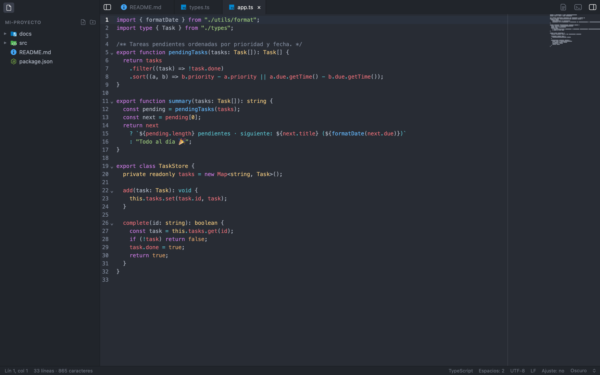
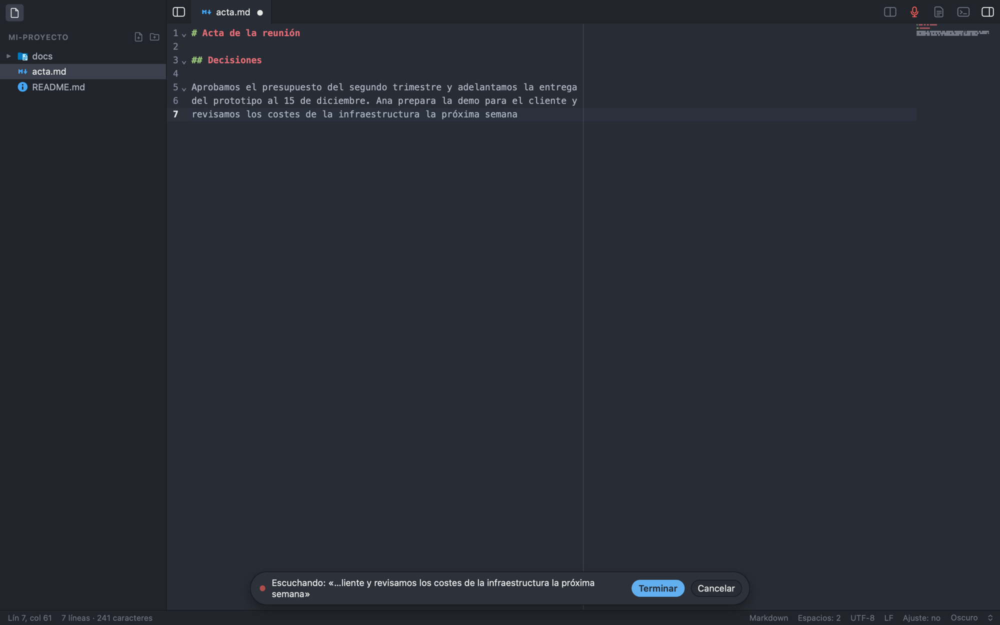
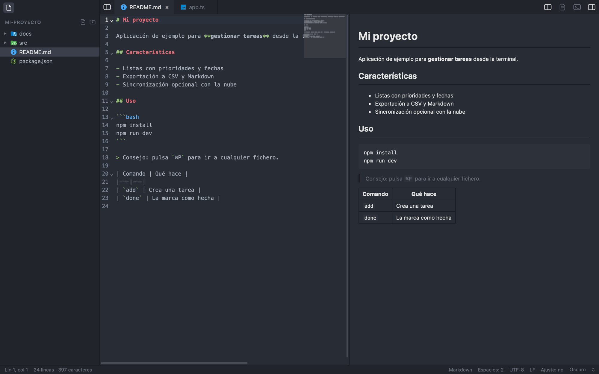
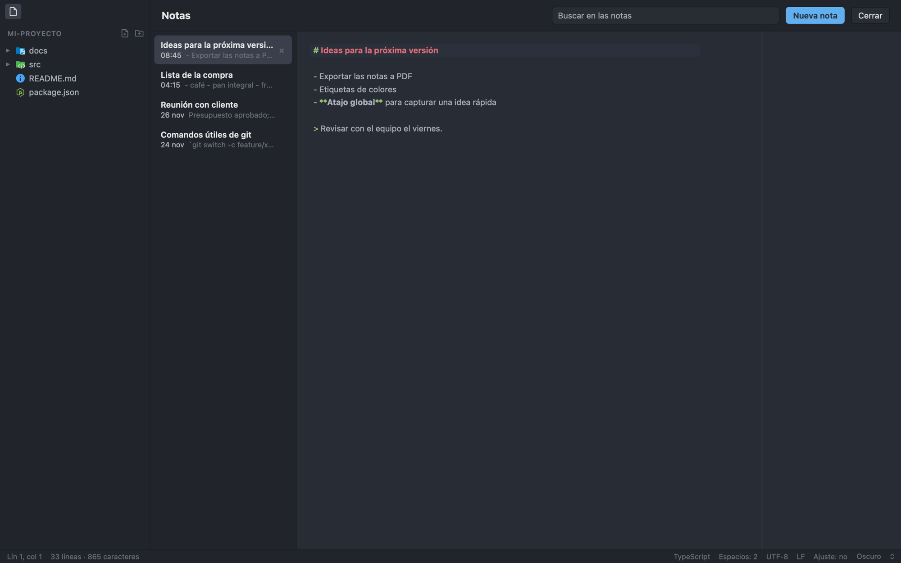

# Kinetext

**El editor de texto nativo para Mac, con Claude integrado y dictado por voz.**

Escribe código, Markdown y notas, o díctalos, en una app ligera que entiende
casi cualquier tipo de fichero y trae a Claude de serie, sin instalar nada más.

[**⬇ Descargar para Mac**](https://github.com/JorchSF/kinetext-releases/releases/latest) ·
macOS con Apple Silicon (M1 o posterior)

---

## Por qué Kinetext

- **Ligero y nativo.** Una app de Mac pequeña, sin el peso de un IDE, para
  abrir una carpeta y ponerte a escribir.
- **Claude dentro de la app.** Pregunta, revisa o reescribe tu código con
  Claude en un panel lateral o en pestañas, con el fichero o la selección como
  contexto (⌥⌘K). Kinetext lo prepara solo la primera vez: no tienes que
  instalar nada.
- **Un solo sitio para todo.** Código, Markdown, CSV, hojas de cálculo, PDF,
  imágenes, bases de datos SQLite, audio, vídeo, comprimidos… se abren en
  pestañas sin cambiar de app.
- **Escribe hablando.** Dicta con el micrófono y el texto aparece mientras
  hablas. Whisper funciona dentro de tu Mac: el audio no sale del equipo y,
  una vez descargado el modelo, no necesitas cuenta ni conexión.
- **No pierdes nada.** Si cierras con cambios sin guardar, al volver siguen
  ahí, con el cursor donde lo dejaste.
- **Hecho para el Mac.** Firmado y notarizado por Apple, con menús nativos,
  modo claro y oscuro, VoiceOver y atajos de macOS.

---

## Lo que puedes hacer

### Dicta en vez de teclear

Pulsa el micrófono o ⌘⇧D y habla: el texto va apareciendo donde está el
cursor, en el editor, en una nota o en el chat de Claude, y se coloca
respetando la guía de margen. Con **comandos de voz** también controlas la
app: «comando guardar», «comando nueva nota», «comando cerrar todas las
pestañas».

### Markdown con vista previa en vivo

Escribe a la izquierda y mira el resultado a la derecha mientras tecleas:
tablas, código resaltado, imágenes y diagramas Mermaid.

### Notas siempre a mano

Una vista propia para tus ideas, listas y apuntes, en Markdown y con buscador.
Se guardan solas mientras escribes. Ábrelas con ⌘⌥N desde cualquier sitio.

### A tu manera

Tema claro u oscuro, tamaño de letra, interlineado, color y grosor del cursor,
minimapa, idioma (español o inglés)… Todo se aplica al momento desde Ajustes,
con buscador, secciones claras y un botón ↺ para devolver cada ajuste a su
valor por defecto.

### Y mucho más

| | |
|:--|:--|
| **Dictado por voz** | Whisper (large-v3-turbo) en el Mac, acelerado con la GPU; en vivo mientras hablas o al terminar, a tu elección |
| **Comandos de voz** | «comando …» ejecuta cualquier acción de la paleta; lo que digas después se escribe a continuación |
| **Varios cursores** | ⌘D para la siguiente coincidencia, ⌘⇧L para todas, ⌥ + arrastrar para editar en columna |
| **Paleta de comandos** | ⌘⇧P para cualquier acción, ⌘P para saltar a cualquier fichero (`ruta:42` va a la línea 42) |
| **Buscar y reemplazar** | En el fichero o en todo el proyecto, con texto o expresiones regulares |
| **Git integrado** | Commit, push, pull, ramas y blame desde el menú; la rama, en la barra de estado. Pestaña **Git** con el grafo de todas las ramas (líneas de colores, merges, autor, fecha y etiquetas) y el diff de cada commit. Se activa sola si tienes git y tu nombre y correo configurados; si falta algo, te dice cómo arreglarlo |
| **Terminal** | La shell de tu Mac en un panel inferior (⌃`), con «Reiniciar» y «Ocultar» junto a su pestaña |
| **Comparar ficheros** | Lado a lado, o un fichero con el contenido del portapapeles |
| **Visores** | PDF con texto seleccionable y OCR, Excel y ODS por hojas, Word, SQLite con consola SQL, audio, vídeo, fuentes y comprimidos con «Extraer aquí» |
| **Pestañas** | Clic derecho para cerrar las demás, las de la derecha o todas; flechas y rueda del ratón cuando no caben |
| **Codificaciones** | Abre y guarda en UTF-8, UTF-16, Windows-1252, Mac Roman y muchas más |
| **Sesión** | Vuelve a abrir la misma carpeta, las mismas pestañas y los mismos cursores |
| **Accesibilidad** | Alto contraste, reducir movimiento, foco reforzado y compatibilidad con VoiceOver |

---

## Instalación

1. Descarga el último `Kinetext_<versión>_aarch64.dmg` desde
   [**Releases**](https://github.com/JorchSF/kinetext-releases/releases/latest).
2. Ábrelo y arrastra **Kinetext** a la carpeta **Aplicaciones**.
3. Abre Kinetext. Está firmado y notarizado por Apple, así que macOS lo abre
   sin avisos de seguridad.

**Requisitos:** un Mac con Apple Silicon (M1, M2, M3, M4 o posterior). Para
usar Claude necesitas tu cuenta de Claude y conexión a internet la primera vez
que lo abras: no hace falta tener VS Code ni ninguna extensión, Kinetext
descarga lo necesario de la fuente oficial al pulsar su icono. El dictado descarga una vez su modelo de voz (unos 1,6 GB) y
macOS te pedirá permiso para el micrófono.

## Actualizaciones

Kinetext busca versiones nuevas al abrirse y desde **Kinetext → Buscar
actualizaciones…**. Si hay una, te enseña las novedades y, si aceptas, la
descarga, la instala y te ofrece reiniciar. Cada paquete va firmado, y la app
rechaza cualquiera que no lo esté. Puedes desactivar la comprobación en
Ajustes.

Las novedades de cada versión están en
[Releases](https://github.com/JorchSF/kinetext-releases/releases).

## Privacidad

Kinetext no tiene cuentas, publicidad ni telemetría, y tus ficheros se quedan
en tu Mac. El dictado se transcribe en el equipo. Solo si usas Claude se envía
a Anthropic, con tu cuenta, lo que le das, y la app te lo pide antes. Detalles
en la [política de privacidad](PRIVACY.md).

---

Kinetext es una aplicación de **Jordi Sánchez Fernández** ([jorch.es](https://jorch.es)).

Este repositorio solo publica los instaladores y las actualizaciones; el código
fuente es privado.

